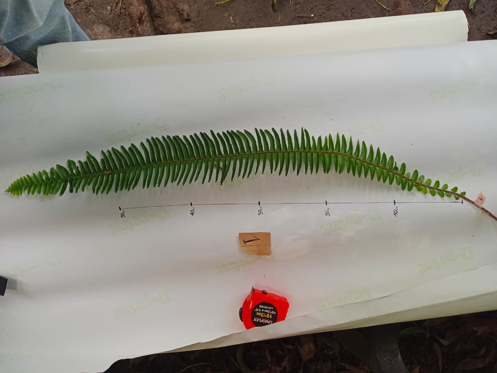
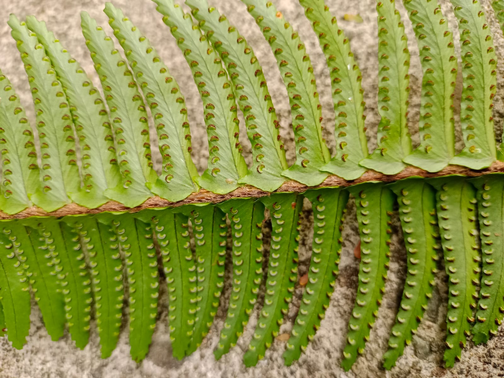
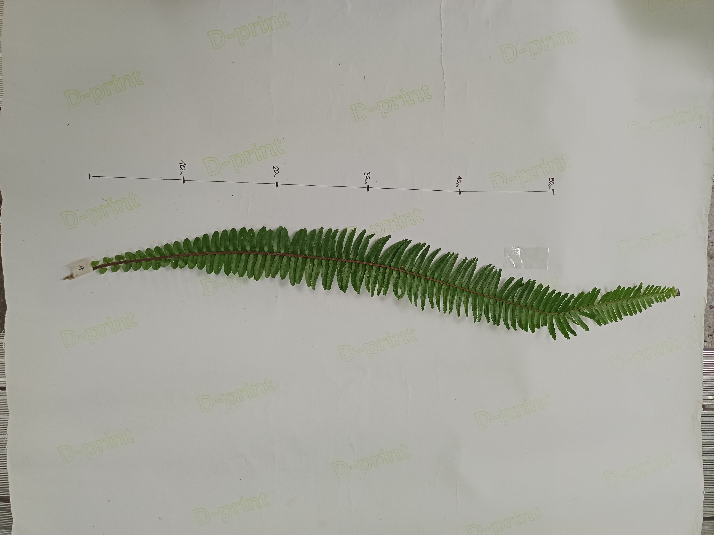
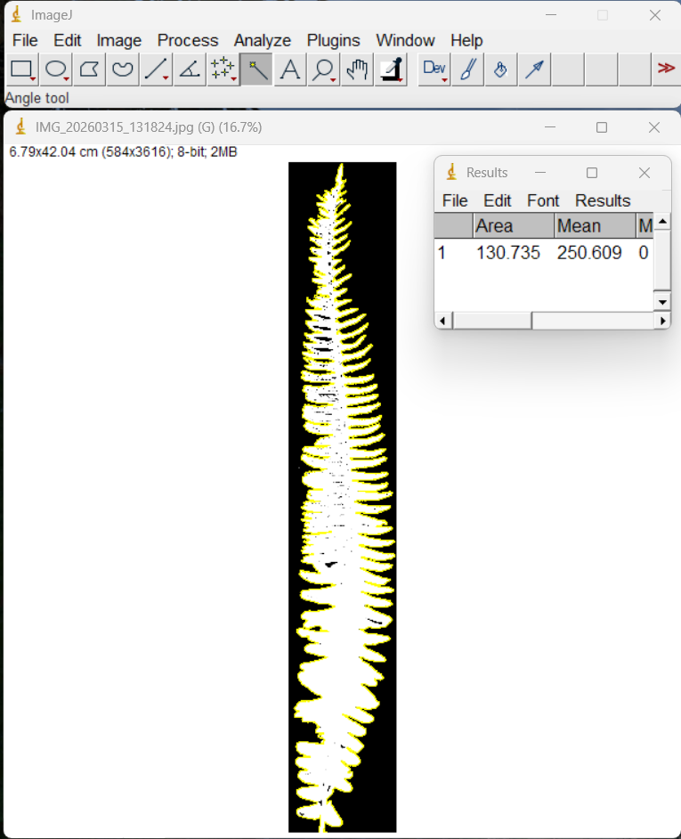

# 🌿 Reproductive Biology of *Nephrolepis* sp.: A Morphometric and Statistical Analysis

*A data science case study on fern reproductive biology, from raw field data to a validated, reusable field-sampling method.*


## Overview

This project began with a simple biological question: does a fern frond's morphometry (length, width, area) relate to how many sori it produces, and is there a recognizable spatial pattern in where those sori appear along the frond? The shape-factor estimation and the reduced-sampling protocol were not part of the original plan, they emerged organically once the morphometric and spatial analyses were done, as practical byproducts of the imputation and curve-shape work already required to answer the original question.

This is exploratory biological research first, and a methods case study second: every step (which correlation coefficient, which regression, which correction) is chosen and justified by what the data actually shows, not applied by default. `n_sori_total` is treated throughout as a countable trait, not as a direct proxy for reproductive output, sorus size, sporangia count per sorus, and spore viability all contribute to actual reproductive capacity and were outside this project's scope. Where the analysis genuinely doesn't support a claim (e.g., no robust relationship between frond size and sori density), the notebooks say so rather than reaching for a positive result.

The dataset comes from original field and image-analysis measurements on 24 individual fronds, with sori counted at the row level along each frond's fertile zone. One individual (H15) had incomplete data, missing both its total sori count and its entire row-level distribution, which motivated the imputation methodology that runs through the middle of this project. A second data-quality issue, unrelated to missingness, is detailed in The Data section below.

## Repository Structure

```
├── assets/
│   ├── frond_photos/         # Reference photos for individual fronds (H01-H24)
│   ├── sori_photos/          # Close-up detail of sori row distribution
│   └── method_screenshots/
├── data/
│   ├── raw/                  # Original, unmodified field data
│   └── processed/            # Cleaned/imputed datasets produced by each notebook
├── notebooks/
│   ├── 01_data_cleaning.ipynb
│   ├── 02_total_sori_imputation.ipynb
│   ├── 03_spatial_distribution_imputation.ipynb
│   ├── 04_sori_density_engineering.ipynb
│   ├── 05_frond_shape_factor.ipynb
│   └── 06_sori_estimation_reduced_sampling.ipynb
├── outputs/
│   └── figures/               # Exported summary figures (one per notebook)
├── src/
│   └── plotting.py           # Shared plotting helpers (e.g. per-frond heatmaps)
├── .gitignore
├── LICENSE
├── README.md
└── requirements.txt
```

Each notebook reads its inputs from `data/processed/` (written by the previous notebook) and exports its own output there, so the pipeline runs end-to-end in numeric order.

## The Data

Two raw datasets, one row per unit of observation:

| Dataset | Granularity | Key columns |
|---|---|---|
| `fronds.csv` | One row per individual (24 total) | `individual_id`, `frond_length_cm`, `frond_width_cm`, `leaf_area_cm2`, `n_sori_total` |
| `sori.csv` | One row per pinna-pair position along a frond (1,921 total) | `individual_id`, `row_id`, `n_sori_per_row` |


`leaf_area_cm2` was measured via digital image analysis (ImageJ); the rest via direct physical/field measurement. Sori were counted on one side of each pinna pair (bilateral symmetry assumed) and doubled to represent the full pair.

Two data-quality issues drive much of the project's methodology:
- **Individual H15** has no row-level sori records at all (100% missing at the row level) and no total sori count either.
- **Individual H19** showed a discrepancy between its recorded total and the sum of its row-level counts, traced to a genuine data-entry error and corrected against the original field records (see `01_data_cleaning`).


## Data Collection & Image Processing

Morphometric measurements and reproductive counts were extracted from original field specimens using standardized digital photography and image analysis tools.

### 1. Primary Biological Data
A total of 24 individual fronds (`H01`–`H24`) were photographed under controlled laboratory settings to assess overall morphology and row-level sori distribution along the fertile zone.

| Representative Frond Sample (`H03`) | Fertile Zone Detail — Sori Rows (`H01`) | Representative Frond Sample (`H14`) |
| :---: | :---: | :---: |
|  |  |  |

*The full collection of original frond photographs is available in the [`assets/frond_photos/`](assets/frond_photos/) directory.*

### 2. Area Extraction via ImageJ
Total surface area ($\text{cm}^2$) for each frond was quantified using **ImageJ** through standardized scale calibration, color thresholding, and automated boundary extraction.


*Figure 1: Digital image processing workflow in ImageJ showing color thresholding and direct frond area calculation.*


## The Pipeline

| # | Notebook | What it does | Key techniques |
|---|----------|---------------|-----------------|
| 01 | **Data Cleaning** | Standardizes column names/types and runs three validation checks (ID uniqueness, referential integrity between datasets, aggregate vs. row-level consistency). Confirms H15's missing data is a complete individual-level gap, and traces H19's discrepancy back to a data-entry error, corrected against original field records. | Data auditing, cross-dataset validation |
| 02 | **Total Sori Imputation** | Imputes H15's missing total sori count. Distribution diagnostics (skewness, Shapiro-Wilk) justify Spearman over Pearson correlation. Compares OLS vs. Theil-Sen regression; Cook's distance and leverage analysis reveal a high-influence individual (H13) that shifts OLS coefficients by 30–50%, motivating the more robust Theil-Sen estimator for the final imputation. | Shapiro-Wilk, Spearman + Bonferroni, Cook's distance/leverage, **Theil-Sen regression** |
| 03 | **Spatial Distribution Imputation** | Imputes *how* H15's sori are distributed along the frond, not just the total. After Benjamini-Hochberg correction across 20 simultaneous tests, no morphometric predictor for curve shape survives, ruling out regression. Implements a weighted KNN-donor method instead (K=9, selected via leave-one-out cross-validation), validated per-individual (mean Pearson r = 0.784). | Feature extraction (5 characteristic curve points), Benjamini-Hochberg, **weighted KNN-donor imputation**, LOO cross-validation |
| 04 | **Sori Density Engineering** | Tests whether larger fronds pack sori more densely, or just proportionally more. After Bonferroni correction, no density relationship survives; a complementary log-log allometric regression (b ≈ 0.55–0.56) cannot rule out isometric growth. | Pearson/Spearman + Bonferroni, allometric scaling, Theil-Sen robustness check |
| 05 | **Frond Shape Factor** | Derives a species-characteristic coefficient K so leaf area can be estimated as `K · length · width`, without image analysis. Two estimation methods (ratio-average, no-intercept regression) converge closely (K ≈ 0.49–0.50). | No-intercept OLS vs. ratio-average, error analysis with photographic validation of outliers |
| 06 | **Sori Estimation via Reduced Sampling** | Validates estimating an individual's total sori count from only 5 sampled rows instead of the typical 60–100, using numerical integration. Combines Simpson's rule and the trapezoidal rule into a hybrid formula, more resistant to sharp sori peaks than either alone. | Simpson's rule, trapezoidal rule, hybrid averaging, leave-one-out-style validation |


## Key Methods Used

- **Robust statistics**: Spearman over Pearson where normality/outliers are violated (verified via Shapiro-Wilk and skewness, not assumed); Theil-Sen regression as a robust alternative to OLS.

- **Multiple comparison correction**: Bonferroni and Benjamini-Hochberg, applied wherever more than one simultaneous hypothesis test is run.

- **Influence diagnostics**: Cook's distance, leverage, and studentized residuals to identify and reason about high-influence observations rather than removing them blindly.

- **Imputation**: regression-based (Theil-Sen) for a scalar target; weighted KNN-donor reconstruction for a full distribution shape, each validated with leave-one-out cross-validation.Imputed values are flagged (`is_imputed`) throughout, so downstream analysis can include or exclude them explicitly.

- **Allometric scaling**: log-log regression to test isometric vs. non-isometric growth.

- **Numerical integration**: A 5-point reduced-sampling protocol (hybrid Simpson's/trapezoidal rule) estimates total sori count with ~6–7% median error, potentially reducing the fieldwork needed per individual by roughly 90%.


## Conclusions

Across the six notebooks, three threads tie the project together:

1. **Frond size and total sori count are related, but not simply.** Sori count correlates moderately with all four morphometric predictors tested (frond length, width, leaf area, and pinna-row count; Spearman rho 0.56–0.67, notebook 02). Leaf area, despite combining length and width, is not the strongest predictor, likely because it carries additional measurement noise from digitization (ImageJ) and individual shape variability that isn't directly tied to reproductive output.

2. **Sori are not distributed proportionally to size once density is considered.** Normalizing sori count by leaf area (notebook 04) reveals a directional trend, larger fronds show lower sori density, and an allometric exponent (b≈0.55) suggestive of negative allometry, but neither result is statistically confirmed at this sample size. This is the project's most open-ended finding, and the one most worth revisiting with a larger sample.

3. **Two field-friendly shortcuts came out of understanding the data's structure well enough to simplify it.** The shape factor (K≈0.50, notebook 05) estimates leaf area from two linear measurements instead of image analysis; the 5-point reduced-sampling protocol (notebook 06) estimates total sori count from a fraction of the rows a full count would require. Neither was the original goal, both are practical byproducts of the deeper analysis.

**Scope and limitations.** This project characterizes patterns in sori count and spatial distribution, it does not measure reproductive capacity directly. Two fronds with the same sori count are not necessarily equally reproductive: sorus size, sporangia count per sorus, and spore viability all matter and were not measured here. The sample size (n=24, with one individual imputed) is also a limiting factor specifically for the density and allometric questions; results there are reported as directionally suggestive rather than statistically confirmed, and documented as such rather than overstated.


## Tech Stack

Python · pandas · numpy · matplotlib · seaborn · scipy.stats · statsmodels · scikit-learn


## Running the Pipeline

Notebooks are numbered and designed to be run in order (01 → 06); each reads the processed output of an earlier notebook rather than the raw data directly (with the exception of `01`, which reads the raw files).

```bash
git clone <repo-url>
cd nephrolepis-sorus-analysis
pip install -r requirements.txt
jupyter notebook notebooks/01_data_cleaning.ipynb
```


## Author

**Juan Felipe Llanos Pérez** — data analysis and biological fieldwork.

## License

This project is licensed under the MIT License — see the [LICENSE](LICENSE) file for details.